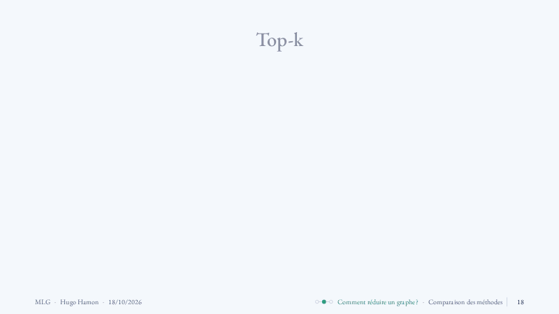
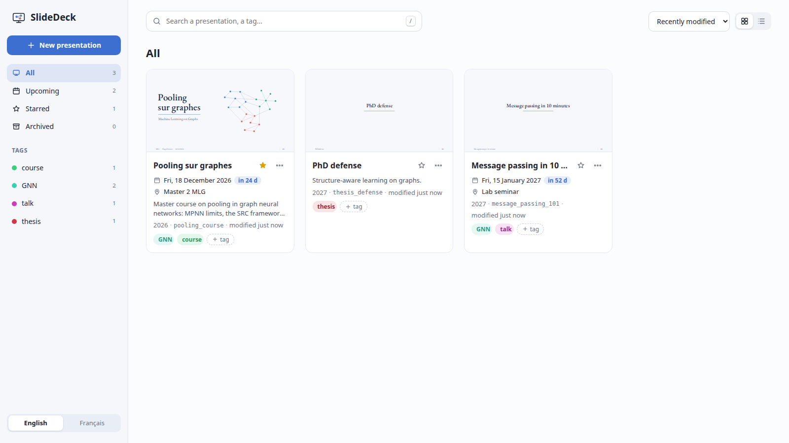
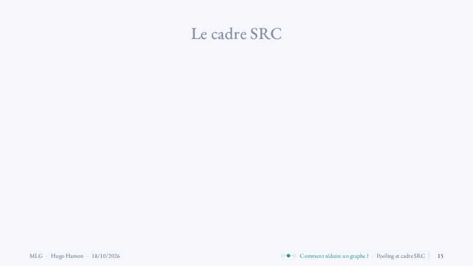
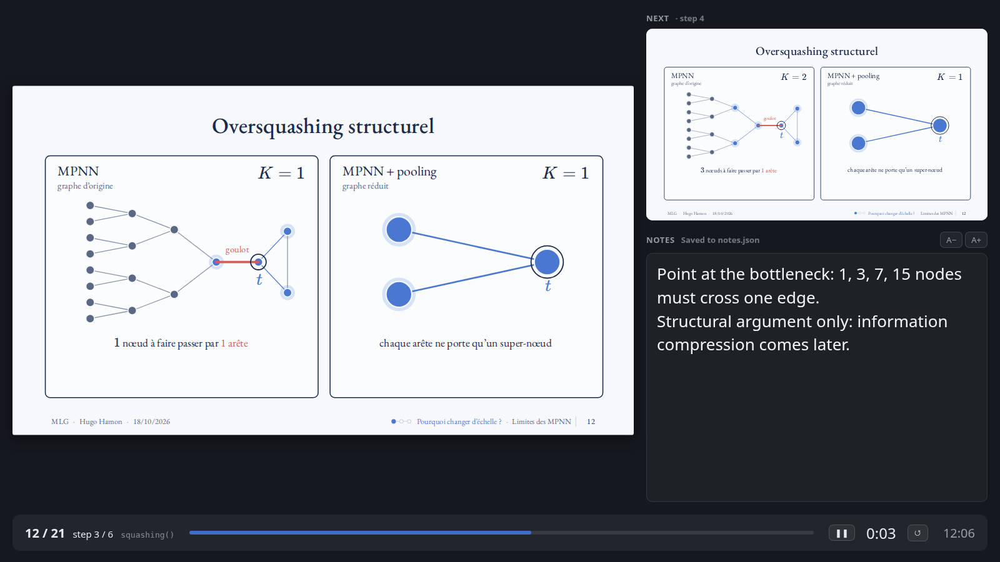
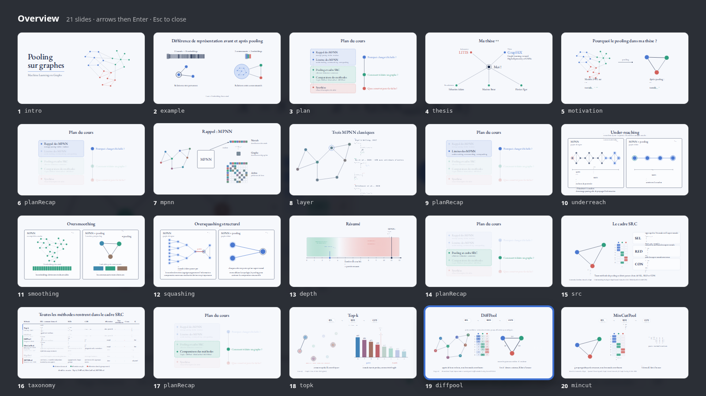
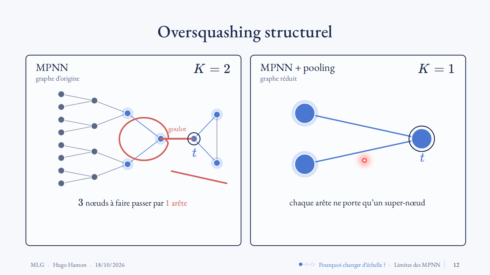
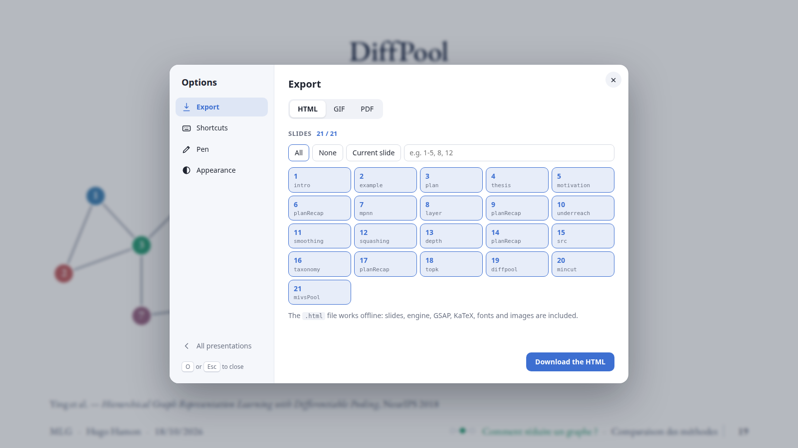
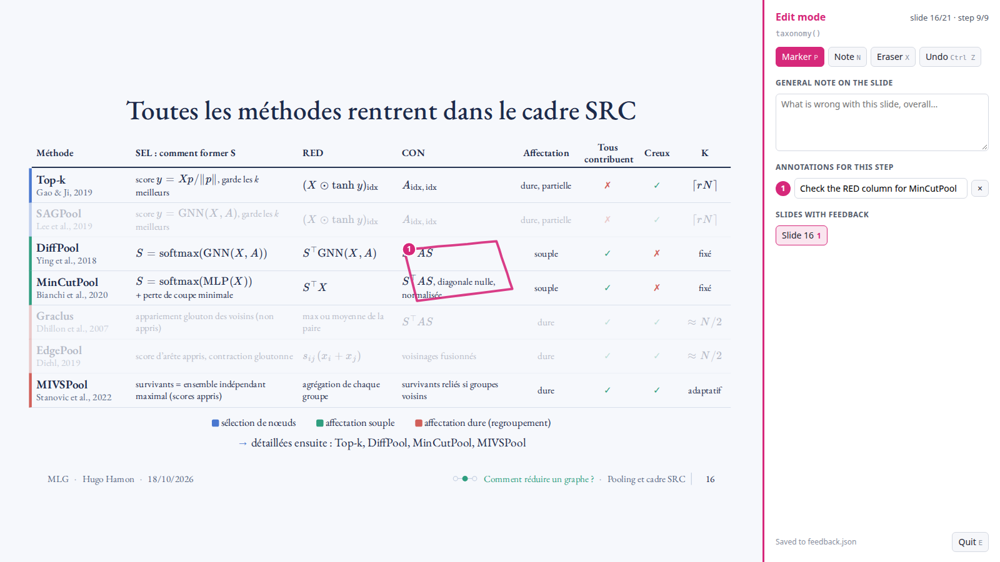

<p align="center">
  <picture>
    <source media="(prefers-color-scheme: dark)" srcset="docs/logo-dark.svg">
    
  </picture>
</p>

<p align="center">
  <b>Animated scientific presentations in plain HTML, SVG and JavaScript.</b><br>
  No build step · step-by-step animations · LaTeX formulas · made to be written with an AI agent
</p>

<p align="center">
  
</p>

SlideDeck is a small toolkit for talks and courses where **ideas are built visually, step by
step**: graphs that contract, matrices that fill in, formulas that appear at the right moment.
Each slide is a JavaScript function that draws its content and describes its animation with
[GSAP](https://gsap.com), while formulas are rendered with [KaTeX](https://katex.org). As soon
as you save a file, the slide reloads on the same step in under a second.

It comes with everything around the slides: a home page for your presentations, a presenter
view with notes, a pen and a laser pointer for remote teaching, and HTML, PDF or GIF export.

## Contents

- [Highlights](#highlights)
- [Quick start](#quick-start)
- [Tour](#tour)
- [Keyboard shortcuts](#keyboard-shortcuts)
- [Writing slides](#writing-slides)
- [Working with an AI agent](#working-with-an-ai-agent)
- [Command-line tools](#command-line-tools)
- [Project layout](#project-layout)
- [Roadmap](#roadmap)

## Highlights

| | |
| --- | --- |
| 🎞️ **Step-by-step animation** | Every slide is a GSAP timeline in which `pause(tl)` marks where the speaker stops. Going back, direct links (`#/slide/step`) and captures are frame-exact. |
| 🗂️ **Home page** | All your presentations with live thumbnails, search, tags, stars, archive, talk date and venue, and an *Upcoming* view. |
| 🎤 **Presenter view** | A second window with the next step, editable speaker notes, a timer and the clock, synced with the projected window. |
| ✏️ **Pen & laser pointer** | Draw over the slides without any menu on screen (colour wheel on long press), or point with a red laser dot. |
| 📚 **Bibliography** | One `references.bib` shared by all your presentations, fed by pasting a DOI, an arXiv identifier or BibTeX. `cite("key")` gives [Kipf & Welling, 2017] and `references()` builds the final slide. |
| 📦 **Export** | A single offline `.html` file, a vector PDF (one page per step or per slide), or animated GIFs. |
| 🤖 **Agent-friendly** | An agent writes the slides, captures every step in a headless browser, checks its own work, and reads the feedback you draw on the slides. |
| 🌍 **English / French** | The interface is in English by default, French in one click. |

## Quick start

```bash
git clone <this repository> && cd SlideDeck
python3 -m venv .venv
.venv/bin/pip install -r requirements.txt
.venv/bin/python -m playwright install chromium   # captures and GIF export only

python3 tools/serve.py                            # → http://localhost:8000/
```

Open the printed address: the home page lists every presentation. Click **New presentation**
to start one from a template, or open the five-slide example in `examples/getting_started/`.

Eleven templates are available, each previewed live in the dialog: Paper (default), Madrid
(the Beamer theme from Overleaf), Metropolis, Swiss, Midnight, Aurora, Editorial, Neo-brutalist,
Blueprint, Chalkboard and Nord. A template is a stylesheet in `deck/themes/` that restyles the
same building blocks (`title`, `cover`, `bullets`, `box` of `deck/components.js`, and the footer).

> An internet connection is needed while presenting from the server: GSAP, KaTeX and the
> EB Garamond font come from a CDN. The HTML export embeds them and works offline.

## Tour

### Home page



Every presentation of `presentations/` and `examples/` with a live thumbnail. Search (`/`), sort, grid or list
view, **stars**, **tags**, **archive**, **duplicate**, **delete** (after confirmation) and **Edit details…** for the title,
description, date and venue of the talk. The **Upcoming** view lists dated talks, closest first.
Library details are saved in `<presentation>/meta.json`, next to the slides.

On the first visit, a welcome window explains what SlideDeck is, how to use it and what it
can do, then offers a **guided tour** of the home page that continues inside a presentation.
The **?** button at the bottom left (or the `?` key) opens it again at any time.
The gear next to it (or `o`) opens the options (language, shortcuts, pen) without entering a
presentation.

### Slides



The visual style is the one of a paper figure: paper background, navy ink, EB Garamond, three
category colours (blue, green, red) with translucent fills. Objects keep their identity: nodes
move and merge rather than disappear and reappear. The example in
`examples/getting_started` has slides built this way.

### Presenter view (`s`)



Opens a second window for your own screen: current slide, next step, **speaker notes**, timer
(starts at the first step forward), clock and progress. Both windows follow each other in both
directions, including the laser pointer, and it also works with an exported HTML file.

Notes are typed right there, one per slide, and saved to `<presentation>/notes.json`. They are
keyed by slide function and occurrence (`planRecap#2`), so a note follows its slide when you
insert slides before it.

### Overview (`g`)



Every slide in its final state. Arrows then `Enter`, or a click, jump to a slide, and the
presenter window follows.

### Pen and laser pointer (`p`, `l`)



Made for remote teaching, with nothing on screen but your strokes:

- **left click** draws and the **wheel** sets the size
- a **long press** opens a colour wheel, and releasing on a colour picks it
- **right click** erases (wheel while right-clicking: eraser size)
- `Ctrl+Z` undoes and `c` clears the slide, while drawings are kept per slide

`l` turns the cursor into a glowing laser dot, mirrored on the projected window when the
presenter view is open.

### Options and export (`o`)



A floating window that groups:

- **Export**, for the slides you pick (click, shift-click, or type `1-5, 8`):
  - **HTML**: one file that works offline (slides, engine, GSAP, KaTeX, fonts, images and notes
    inlined, about 1.5 MB), built in the browser.
  - **PDF**: one page per step or per slide, through the browser's *Save as PDF*, with text and
    formulas that stay vector and selectable.
  - **GIF**: rendered frame by frame by the local server, one GIF per slide (zipped) or a single
    one, with looping slides exported as one seamless cycle.
- **Shortcuts**: rebind every key.
- **Pen**: wheel colours and default sizes.
- **Appearance**: interface language (English / French) and the backdrop around the slide.

### Edit mode: feedback for the agent (`e`)



Circle what is wrong, drop numbered notes, write a general note per slide. Feedback is saved to
`<presentation>/feedback.json` with the circled elements (tag, text, LaTeX, position), so an
agent can find the code to change. See [Working with an AI agent](#working-with-an-ai-agent).

### Bibliography (`b`)

Every presentation reads the nearest `references.bib` above its folder, usually
`presentations/references.bib`, which all your talks share. The `b` window lists it:

- **Add**: paste a DOI, an arXiv identifier (or their URLs) or BibTeX, several at once. The
  server fetches the BibTeX, names the key `lastname+year` (`kipf2017`) and skips a work that is
  already there.
- **Find and copy**: search by author, title or key, filter on the works cited in this
  presentation, and copy `cite("key")` to paste it in an Edit-mode note or a message to the
  agent, which adds it to the slide. Each entry shows the other presentations that cite it.

On the **home page**, the *Bibliography* view manages the whole file: every reference with the
presentations and slide numbers citing it (a click opens the slide), filters *Cited*, *Not cited*
and *Missing* (keys cited in a slide but absent from the file), addition, BibTeX editing and
deletion. Renaming a cited key can update the `cite()` calls in the slides at the same time.

The file stays plain BibTeX, so you can edit it by hand (the slides reload) or reuse it in LaTeX.
In an exported HTML file the window is read-only and only carries the cited works.

## Keyboard shortcuts

All of them can be changed in **Options → Shortcuts**.

| Key | Action | Key | Action |
| --- | --- | --- | --- |
| `→` `Space` `PageDown` | next step | `s` | presenter view |
| `←` `PageUp` | previous step | `g` | overview |
| `Home` / `End` | first / last slide | `l` | laser pointer |
| `f` | fullscreen | `p` | pen (`Ctrl+Z` undo, `c` clear) |
| `o` | options | `e` | edit mode |
| `h` | home page | `b` | bibliography |
| `Esc` | leave the current mode | | |

## Writing slides

A presentation is a folder in which `index.html` lists the slides and the footer, while each
slide lives in `pages/`. A slide builds its content **in its final state**, then describes how it appears:

```js
import { gsap } from "gsap";
import { pause } from "deck/deck.js";
import { div, title } from "deck/components.js";

export default function cover(root) {            // root: an empty 1920×1080 stage
  const heading = title(root, "Pooling on graphs", 430);
  const rule = div(root, "abs", { x: 760, y: 540, w: 400, h: 3, style: { background: "var(--blue)" } });

  const tl = gsap.timeline({ defaults: { ease: "expo.out" } });
  tl.from(heading, { opacity: 0, y: 24, duration: 0.9 });
  pause(tl);                                      // the speaker stops here
  tl.from(rule, { scaleX: 0, duration: 0.8, ease: "power3.inOut" });
  pause(tl);
  return tl;
}
```

The state depends only on the timeline's time, which is why going back, direct links and
captures are exact. Shared building blocks (SVG, labels, KaTeX, arrows) are in
[`deck/components.js`](deck/components.js), and colours come from the theme
([`deck/theme.css`](deck/theme.css)). The full rules (structure, design, motion) are in
[`AGENTS.md`](AGENTS.md).

**Citations** use the author-year style. `cite()` and `citet()` return HTML to put in any text,
and `references()` builds the references slide in the look of the presentation's theme:

```js
import { cite, citet, references } from "deck/components.js";

label(root, `Message passing ${cite("kipf2017")}`, 960, 900, 28);   // [Kipf & Welling, 2017]
bullets(root, [`${citet("grattarola2024")} compare pooling methods`]); // Grattarola et al. (2024)
cite("kipf2017", "grattarola2024", { page: "p. 3" });                // several works, a page

export default function bibliography(root) {      // last slide: every work cited in pages/*.js
  const { heading, items } = references(root);    // { start, count } to split a long list
  const tl = gsap.timeline({ defaults: { ease: "expo.out" } });
  tl.from(heading, { opacity: 0, y: -16, duration: 0.7 });
  tl.from(items, { opacity: 0, y: 16, duration: 0.6, stagger: 0.05 }, "<0.2");
  return tl;
}
```

An unknown key shows as a red **[?key]** and is reported by `tools/capture.py`. Call `cite()`
inside the slide function (the bibliography is loaded when the deck starts) and write the key in
full, so that `references()` and the home page find it.

## Working with an AI agent

SlideDeck is designed to be authored with a coding agent (Claude Code, Codex…), which follows
[`AGENTS.md`](AGENTS.md). Claude Code loads it automatically through `CLAUDE.md`.

1. **Ask for a slide**: *"In my_talk, add a slide showing message passing on a small graph,
   in three steps."*
2. **The agent checks its work**: it captures every step in a headless browser and reads the
   contact sheet and the report (console errors, elements out of frame).
   ```bash
   .venv/bin/python tools/capture.py presentations/2026/my_talk
   ```
3. **You give feedback on the slides**: press `e`, circle and comment, then tell the agent
   *"read my feedback"*. It runs `tools/review.py`, which produces a summary and one annotated
   capture per step.
4. **You cite a work**: copy `cite("key")` from the `b` window and write *"add cite("kipf2017")
   after the definition on slide 3"*, in the chat or in an Edit-mode note.

## Command-line tools

| Command | What it does |
| --- | --- |
| `python3 tools/serve.py [presentation]` | Local server with live reload, home page, notes, feedback and GIF export. |
| `python3 tools/new.py presentations/2026/my_talk --title "My talk" [--theme madrid] [--author "…"]` | New presentation from a template (also available from the home page). |
| `.venv/bin/python tools/capture.py <presentation> [--slide N] [--frames 2]` | One image per step → `.inspection/storyboard.jpg` and `report.json`. |
| `.venv/bin/python tools/review.py <presentation> [--clear]` | Edit-mode feedback → `.inspection/review/review.md` and annotated captures. |
| `.venv/bin/python tools/gif.py <presentation> [--slide 3 5] [--combined]` | Animated GIFs (`--fps`, `--width`, `--hold`, `--once`). |
| `python3 tools/bib.py <presentation> [--add DOI arXiv file.bib…]` | Shared bibliography: file used, cited keys (unknown ones flagged), additions. |

## Project layout

```text
deck/            the shared engine
                 deck.js (navigation), components.js, theme.css, themes/*.css (templates)
                 options.*, pen.js, laser.js, presenter.js + notes.js, overview.js,
                 export.js (HTML), print.js (PDF), review.* (edit mode), home.*, i18n.js,
                 bib.js + bibliography.js (citations and the b window)
tools/           serve.py · library.py · capture.py · review.py · gif.py · new.py · bib.py
templates/       starting point for new presentations
presentations/   <year>/<name>/ index.html · pages/*.js · assets/ · meta.json · notes.json
                 references.bib (bibliography shared by every presentation)
                 (ignored by Git, so you can keep it in a repository of its own)
examples/        <name>/ a bundled example, shown on the home page like your presentations
docs/            logo and README images
```

## Roadmap

- **MCQ / quiz slides**: a specific slide for multiple-choice questions.
- **Shared component library**: promote the building blocks written for courses (comparison
  panels, assignment matrix, SEL → RED → CON stepper…) to `deck/components.js`, with a gallery.

## Credits

Built on [GSAP](https://gsap.com), [KaTeX](https://katex.org),
[EB Garamond](https://fonts.google.com/specimen/EB+Garamond) and
[Playwright](https://playwright.dev) (captures and GIF export).
